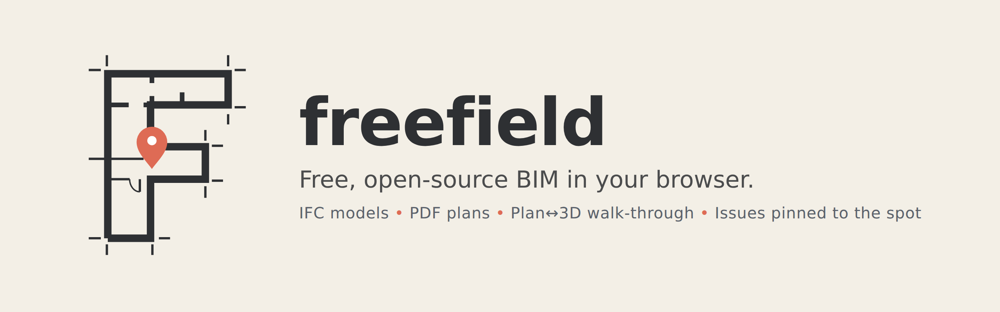
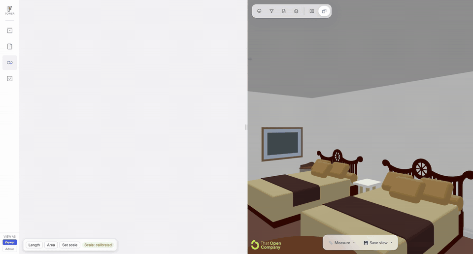
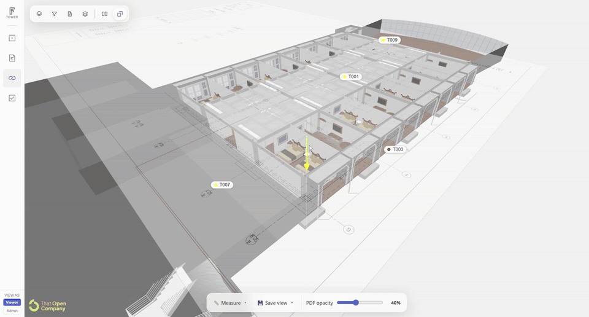
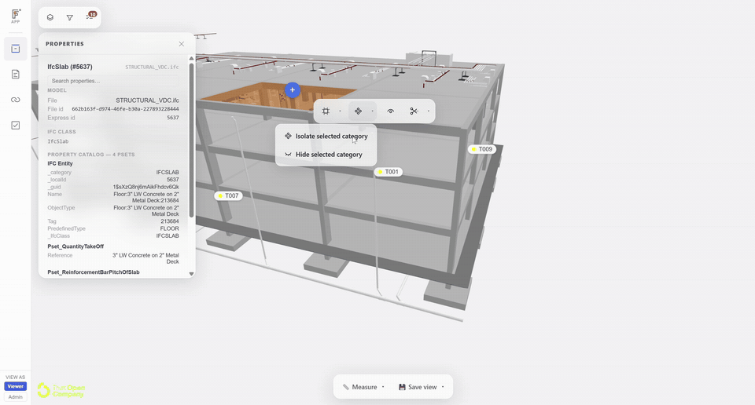
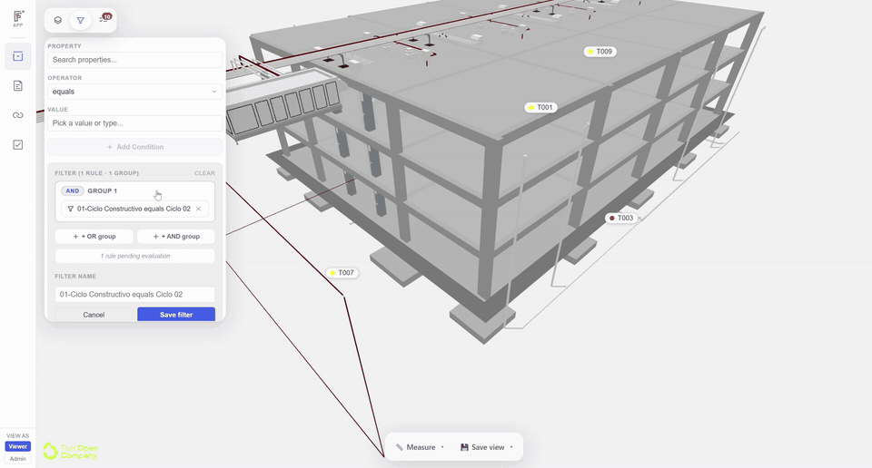
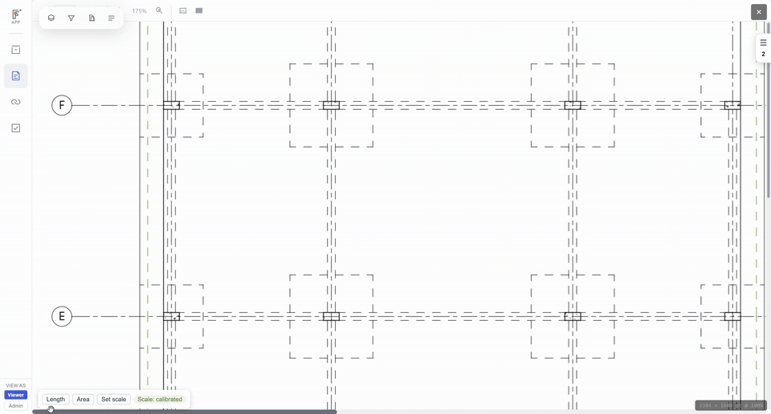
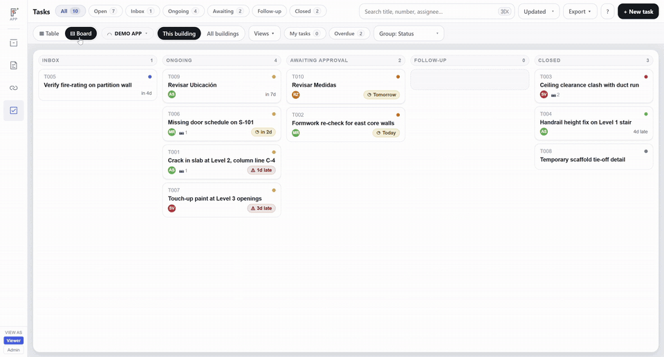
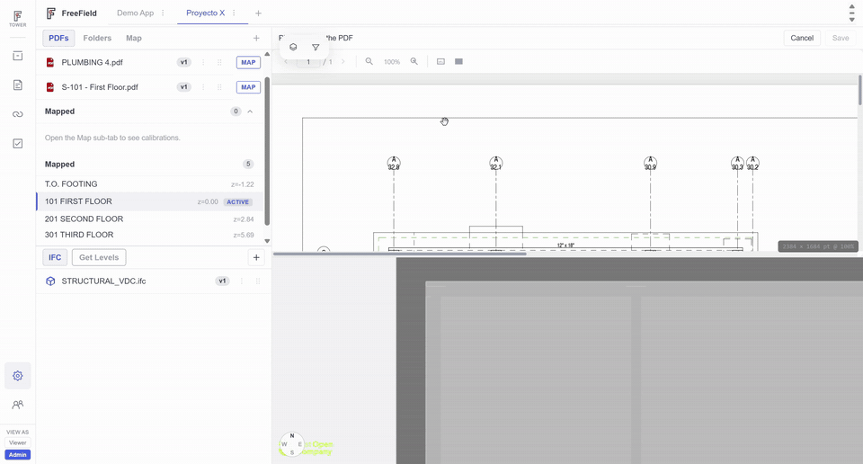

<p align="center">
  
</p>

<p align="center">
  <a href="LICENSE"></a>
  
  
  
</p>

**FreeField** brings your **IFC models**, **PDF floor plans** and **site issues** together in one place, entirely in the browser. Line a drawing up with the model once, and from then on the plan and the 3D model are linked everywhere: walk the building from the plan, measure in real units, and pin issues to the exact spot.

- **No install.** It's a web app. IFC files are converted in your browser and stay on your machine.
- **Try it in a minute.** Clone, install, run, and open the included sample IFC model. No account needed.
- **Yours to host.** Run it on your own Firebase project when you want sign-in and a shared task list.

<p align="center">
  
  <br><sub><b>LinkView</b> — drag a dot on the drawing and stand inside the building. Walk in 3D and the marker follows on the plan.</sub>
</p>

---

## Quick start

Requirements: **Node.js 20+** and **pnpm 10**.

```bash
git clone https://github.com/theagentmarvin/free-field-app.git
cd free-field-app
pnpm install
pnpm --filter settings dev
```

Open <http://localhost:5173>. The app starts in **demo mode**: no sign-in, no backend, and everything is stored in your browser.

**Load the sample model:**

1. At the bottom of the left rail, switch **View as** to **Admin**, then click **Settings** in the rail.
2. Create a building with the **+** tab.
3. Click **Browse** and pick [`apps/settings/public/samples/sample.ifc`](apps/settings/public/samples/sample.ifc). It's a small structural model, converted right in your browser.
4. Click **Get Levels** to cut 2D floor plans from the model, then open **Models** to explore it in 3D.
5. Have a PDF floor plan? Upload it in Settings and use **Map** to line it up with the model in four clicks. That unlocks LinkView, plan measuring in metres, and tasks pinned to the plan.

Your own IFC files work the same way.

Want sign-in, roles and a shared task list? See [Self-hosting](#self-hosting-on-your-own-firebase).

---

## What's inside

### LinkView: the plan and the model, linked



- **Split view:** the PDF plan beside the 3D model.
- **"You are here" marker:** drag it on the plan and the 3D camera jumps there, at eye height (1.65 m).
- **First-person walk:** drag to look, `W A S D` / arrows to walk, `Shift` to run, touch buttons on phones. Linked **both ways**.
- **Overlap mode:** the calibrated plan is draped onto the model, with an opacity slider.
- The same **Models & Levels** and **Filters** tools as the 3D viewer, plus measuring on the plan (in metres) and in 3D.

### Models: a federated 3D viewer



- **Architecture, MEP and structure together,** with per-model on/off switches. Levels open as true 2D plans cut from the model.
- **Instant selection** and a searchable properties panel grouped by property set.
- **Right-click toolbar:** isolate or hide an element or category, and add section planes (up to 8) with cut-edge outlines.
- **Measure** length, area, angle and volume, with snapping to vertices, edges and faces.
- **Saved views:** camera, section planes and hidden elements, recalled with an animated camera move.
- **Smooth on big models:** render-on-demand (no GPU work while idle) and a local geometry cache.



**Custom filters** on any property your model already has: autocomplete, 12+ operators, AND/OR groups and a live match count.

### Documents: plans you can measure



- A PDF reader with zoom, fit, multi-page navigation, outline and thumbnails, and a folder tree with versions.
- **Measure in real units:** lengths (with a running total) and areas (with perimeter), using the plan's calibration. An uncalibrated plan says so with an amber `pt` badge, so it never guesses metres.
- **Tap the plan to raise an issue** right there, with an auto-cropped snapshot.
- **Compare revisions:** put two versions of a sheet side by side, overlaid, or as a list of changed regions you can step through and export.

### Tasks: issues pinned to the exact spot



- Pin issues to a **3D element** or a **spot on a plan**. Clicking a pin flies the camera back to where the issue was raised.
- **Table and board** views, with types (Defect, RFI, Snag, Safety, Info), deadlines, assignees, photos, comments and an activity timeline.
- A status workflow that only allows legal moves (also enforced server-side), bulk actions, CSV and **BCF 2.1/3.0 export**, keyboard shortcuts, and a **printable task report**.
- Live sync between teammates when signed in.

### Settings: set up a building



- **IFC import in the browser** (Web Worker, progress and cancel, bundled `web-ifc` WASM), with versioning and duplicate detection.
- **Get Levels:** pick storeys and get real floor plans cut from the model.
- **PDF plans** with versions and colour-coded folders.
- **Two-point calibration:** two clicks on the drawing and two on the model. That's what links plan and model everywhere else.

### Teams (when self-hosted)

Passwordless **email-link sign-in**, **invite links** with Admin or Member roles per project, membership in several projects, immediate access revocation, and sign-out that clears local data on shared devices.

---

## How your data is stored

FreeField is **local-first**. Buildings, IFC/PDF versions, calibrations and saved views start in **your browser** (IndexedDB). When you self-host with sign-in, **tasks, members and projects** sync through your own Firestore, and an admin can **publish** buildings so the converted models, PDFs and calibrations sync to your own Firebase (Firestore + Storage) for the whole team. The original IFC file is not uploaded. Anything never published stays only in that browser, so clearing the site data removes it. The UI is a responsive web app that also works in a phone or tablet browser. A native Android field app with durable offline storage is opening as its own repo soon.

## Self-hosting on your own Firebase

Each organisation runs its **own** Firebase project (Auth, Firestore, Storage, Functions, Hosting). Copy the `.env.example` templates, fill in your project's values, and deploy. Start with the [self-hosting guide](docs/deploy/self-hosting.md); the shorter runbook is [docs/deploy/README.md](docs/deploy/README.md).

## Tech stack

TypeScript (strict) · React 18 · Vite 5 · pnpm workspaces + Turborepo · Vitest. 3D: [`@thatopen/components`](https://github.com/ThatOpen/engine_components) and [`@thatopen/fragments`](https://github.com/ThatOpen/engine_fragment) on three.js, with [`web-ifc`](https://github.com/ThatOpen/engine_web-ifc) (WASM served locally). PDFs: `pdfjs-dist`. Storage: Dexie (IndexedDB). Backend (optional): Firebase Auth, Firestore, Functions.

```
apps/settings     host app: routing shell, demo mode, Settings module
apps/models       3D viewer          apps/linkview   plan ↔ 3D
apps/documents    PDF plans          apps/users      members & invites
packages/ff-*     shared foundation: viewer engine + React bindings, viewer tools,
                  data (Dexie), auth, Firestore rules & functions, tasks, telemetry, types
```

## Development

```bash
pnpm test                          # all workspaces (Vitest)
pnpm typecheck
pnpm --filter settings lint        # ESLint (bans raw `three` imports outside the engine)
pnpm --filter settings lint:drift  # engine-boundary check
pnpm --filter @free-field/settings build
```

`pnpm test` needs no emulator. The rules, functions and sync emulator suites run with `pnpm test:emulator` (JDK 21). See [CONTRIBUTING.md](CONTRIBUTING.md).

## Contributing

Issues and pull requests are welcome: bug reports, IFC files that don't load well, UX ideas, docs. Start with [CONTRIBUTING.md](CONTRIBUTING.md) and the [Code of Conduct](CODE_OF_CONDUCT.md). Please report security issues privately, as described in [SECURITY.md](SECURITY.md).

## License

[MIT](LICENSE) © 2026 FreeField contributors.
